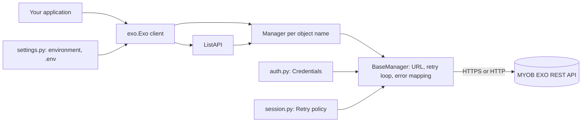

# pyexo architecture

pyexo is a client library, not a deployed system. This page states plainly what it does and does not have,
so the architecture check has a complete answer for each category.

## Diagram

## Services

None. pyexo ships no server, daemon or worker. It is a Python package imported into the caller's process.

Modules in `exo/`:

| Module | Role |
| --- | --- |
| `api.py` | `Exo` (one lazy client, cached managers, `discovery()`, context manager) and `ListAPI` |
| `manager.py` / `basemanager.py` | `Manager` per object name; `all`, `iter_all`, `get`, `search`, `put`, `save`, `delete`; the single retry loop |
| `auth.py` | `Credentials`: builds the three EXO headers |
| `settings.py` | Reads configuration from the environment, then a `.env` file |
| `session.py` | Retry policy shared by a client's managers (429, 502, 503, 504; `Retry-After` capped at 60 s) |
| `names.py` | The object names the EXO API exposes |
| `exceptions.py` | Maps HTTP error responses to exception types |

## Routes

pyexo exposes no routes. It calls these EXO REST paths relative to the base URL:

- `GET /discovery`
- `GET /<object>`, `GET /<object>/<id>`, `GET /<object>/search?q=...` (paged with `page` and `pagesize`)
- `POST /<object>` (`save`), `PUT /<object>` (`put`), `DELETE /<object>/<id>`

POST is never retried. Details are in `api-notes.md` (docs/).

## Data stores

None. Nothing is persisted. Configuration may be read from a local `.env` file, which is read only.

## Queues

None. Calls are synchronous; retries happen in-process with backoff.

## External dependencies

- MYOB EXO REST API: on-premise (`http://<host>:<port>`) or cloud (`https://exo.api.myob.com`). Every request
  carries `Authorization: Basic`, `x-myobapi-key` and `x-myobapi-exotoken`.
- Runtime Python packages: `requests` and `urllib3`.
- Dev only: ruff, mypy, pytest, coverage.

## Deploy targets and machines

- Distribution: a package on PyPI (`pip install pyexo`); publishing is done by the owner by hand.
- Checks run locally with `scripts/check.sh`; there is no CI workflow and no hosted environment.
- No machines, containers or cloud resources.

## Keeping this current

Update this page and the diagram when a service, route, data store, queue, external dependency or deploy
target is added.
